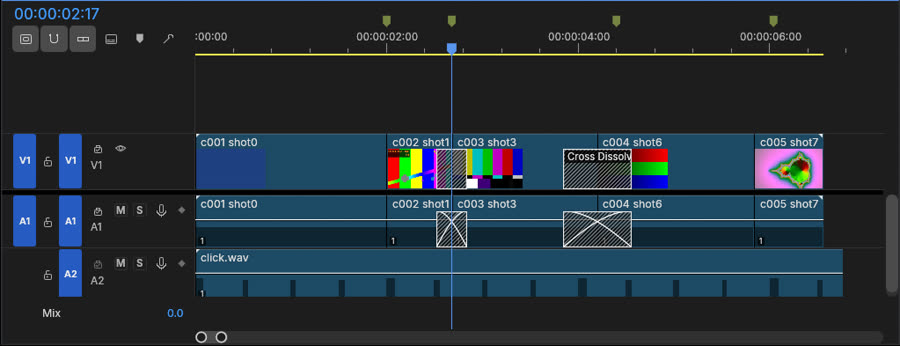

# FilmCraft as an optional visual editing companion: feasibility

**Status: experiment, run once (2026-10-30) in a headless Linux container.** The question is whether
[FilmCraft](https://github.com/storytold/filmcraft) can be an *optional* visual editor for a matchcut cut, alongside
Resolve (M2c) and mpv (M2b). It is not a plan to replace matchcut's FFmpeg renderer, its Textual TUI or its canonical
timeline. No adapter was written, and nothing under `matchcut/` changed. The proof is a re-runnable script:
[prototypes/filmcraft/](../prototypes/filmcraft/README.md).

- **M2a, M2b and M1 human gates: PENDING** (unchanged by this experiment).
- **Labels used below.** **Observed** means seen by running it here, with the step of the proof that shows it.
  **Docs claim** means FilmCraft's own documentation says it and this experiment did not check it. **Not tested** is said
  where it applies.

## Verdict

FilmCraft did every editing step the proof asked of it. matchcut's own OTIO export went in, an agent navigated to junction 2 and trimmed
c003's in point by 5 frames through the MCP server, the CLI and the desktop app's control channel, and the cut came
back. Out of FilmCraft as OTIO, FCPXML or EDL, matchcut's `import` read **exactly one human decision,
`human trimmed c003: in +5f`**, frame for frame against `final.json`. All of it ran headless, with no GPU, in about a
minute.

What does not survive is matchcut's own information. FilmCraft writes none of `metadata.matchcut` back: no stage
fingerprint, no clip keys, and none of the music's gain, fade or ducking. matchcut gets its clip identity back only
because M2a's importer re-matches clips by source range. FilmCraft also renders dissolves differently from
matchcut's ffmpeg render (in linear light).

**Does FilmCraft's MCP/control architecture beat matchcut editing its own canonical timeline? No.** For an edit an agent
decides, matchcut applying it to its own timeline (as a new stage) and rendering with ffmpeg is exact, keeps provenance, and needs no 43 MB binary,
no second timeline model and no lossy round trip. FilmCraft is worth something in one role: **a free, scriptable,
open-source timeline GUI in which a person makes the edit**. Unlike Resolve, its import and export can be tested in CI.
That role is M2a's existing round trip. **Recommendation: no production adapter now.** Keep this proof as an optional
conformance check, and revisit if a person actually wants FilmCraft as their editor (see "Recommended next steps").

## Environment and versions

| | |
|---|---|
| FilmCraft | commit `fed0f42` ("UPD.1: honor app pretend versions in update checks (#3668)", 2026-10-30), version 0.14.0, shallow clone, unmodified |
| matchcut | `main` at `4b2e2df` (this branch's base), run from this checkout |
| Platform | Ubuntu 24.04.5 container, Linux 6.18 x86_64, glibc 2.39, 4 vCPUs, 15 GB RAM, **no GPU, no `/dev/dri`** (no VA-API/NVDEC) |
| Toolchain | Rust 1.97.0 (FilmCraft asks for 1.95+), Python 3.13.16, ffmpeg 6.1.1 |
| Display | Xvfb 21.1.12 (`:97`, 1920x1080x24); Vulkan through Mesa 25.2.8 llvmpipe (software) |
| Media | matchcut's synthetic fixtures only: 320x180 H.264/AAC at 25, 30000/1001 (DF timecode 00:59:59;00) and 24000/1001 fps, one with timecode 01:00:00:00; a click track as WAV, MP3 and AAC (M4A) |

**What a headless container cannot say.** Nothing here measures the app on a real GPU, hardware decoding, playback,
audio output (there was no sound device), real camera or phone media, macOS or Windows, or the experience of a person
editing. The GUI ran under Xvfb on a software Vulkan adapter, and FilmCraft then composites on the CPU.

## 1. Build (observed)

| | CLI (`-p filmcraft-cli`) | Desktop app (`-p filmcraft`) |
|---|---|---|
| Build (release, thin LTO, `codegen-units = 1`) | 6 min 29 s cold, 4 cores | 9 min 53 s more, sharing the CLI's dependencies |
| Binary | 43.3 MB | 77.4 MB |
| System packages | none beyond the base image | `libasound2-dev` to build (cpal); `libxkbcommon-x11-0` at run time, without which winit **panics at start-up**; `mesa-vulkan-drivers` for a Vulkan adapter; `xvfb` |
| Target directory | 2.3 GB for both, plus the test build | |

Cargo fetched git dependencies from two GitHub repositories (`storytold/craft-libs`, the `storytold/egui` fork); the build needs
network access the first time. No feature flags were needed. The `whisper` feature was not built.

## 2. CLI and headless engine (observed)

- `filmcraft-cli commands` lists **711 commands** (the README claims "more than 650"). `describe <id>` gives each
  command's parameter shape, and `--json` gives machine output.
- **There is a real headless engine.** `filmcraft-cli --project p.fcproj [--save] exec|run|inspect|import|export|render`
  runs one process per call. `run -` takes JSON lines, and the project is saved back with `--save`. The proof's step 10
  does the whole trim this way: import, inspect, link, trim and OTIO export, in 0.03 s.
- `inspect sequence` returns tracks, clips (start, duration and source in/out in ticks **and frames**), transitions
  (from/to clip, start, duration, alignment), markers, playhead and selection. Time is integer ticks (254,016,000,000
  per second).
- `render --seconds S --out f.png` renders one program frame. `export out.mp4` renders the sequence, and the CLI
  infers the format from the extension.

## 3. MCP server and control channel (observed)

| | Started with | Needs the GUI | Observed |
|---|---|---|---|
| MCP, headless | `filmcraft-cli mcp` (stdio; `--project`, `--demo`, or empty) | no | `initialize` (protocol 2025-06-18), `tools/list` with **17 tools**: `command_list`, `command_run`, `command_batch`, `doc_inspect`, `project_inspect`, `sequence_inspect`, `media_import`, `render_frame`, `render_preview`, and 8 `ui_*` tools. The `ui_*` tools answer "this tool drives the live app" in headless mode (**Unsupported** there, as documented). Start plus initialize: 7 ms |
| Control channel | `filmcraft --control PORT` (desktop app), token `FILMCRAFT_CONTROL_TOKEN` | **yes** | Under Xvfb, `engine.commands` (711), `engine.execute` (import, inspect, `playhead.set`, link, trim, export), `ui.inspect`, `ui.timeline.locate`, `ui.screenshot` (window, Timeline, Program; 0.5–0.7 s each), `app.quit`. A wrong token is refused and the connection closed |
| MCP, bridge | `filmcraft-cli mcp --bridge 127.0.0.1:PORT` | yes | `tools/list`, `sequence_inspect` (sees the app's trim), `render_frame` (a Program monitor screenshot), `ui_screenshot`, `command_run edit.undo` |

So the JSON control channel exists only in the desktop app. Everything matchcut would need, though, is available
headless through the CLI or the headless MCP server, both of which drive the same engine commands. The app opened its
demo project at start, and an import there merges into it; the headless server starts with an empty project. At launch
the app also made an update check to GitHub (the proxy refused it), and it found no audio device.

*The Timeline after the ripple trim (bridge `ui_screenshot`). V1 and A1 hold matchcut's five clips, with the J2 and J3
dissolves as transitions. A2 holds the click track, now 5 frames longer than the picture. The junction markers sit on
the ruler; J3 and J4 did not ripple.*

## 4. The proof on matchcut's real exports

Fixture: `run --backend mock -t 8 --music click.wav` on matchcut's demo footage gives 5 clips. Junction 2 (s1-s3) is an
8-frame dissolve and junction 3 an 18-frame dissolve, at 25 fps. Results are from `proof.py` (78 checks: 67 Passed,
0 Failed, 1 Unsupported, 10 Not preserved) and `control_channel.py` (18 Passed); see
[prototypes/filmcraft/recorded-run/](../prototypes/filmcraft/recorded-run/).

| # | Step | Outcome | Evidence |
|---|---|---|---|
| 4.1 | Import `final.otio` (`file.import`) | **Passed** | Both media linked, empty report, 12 ms. V1, A1 and A2 match matchcut's OTIO clip for clip: names, source in and duration in frames |
| | Cuts and dissolves | **Passed** | Two `cross_dissolve` transitions, centred, at frames 63–71 and 101–119, exactly matchcut's 4+4 and 9+9 frames. The A1 mirror's become `constant_power` crossfades |
| | Music (A2) | **Passed** | `click.wav` from 0, 169 frames |
| | Junction markers | **Passed** | `J1 s0->s1`@50, `J2 s1->s3`@67, `J3`@110, `J4`@151, with the why line as the comment. They move from the V1 track to sequence markers |
| | `metadata.matchcut` | **Not preserved** | Not exposed by the agent API, and not written back (4.6) |
| | Frame size | approximated | The OTIO has none, so FilmCraft uses 1920x1080 and places the 320x180 clips unscaled in the centre. `sequence.settings` to 320x180 left the clips off-frame (black), and `scaleMotion: true` shrank them to 16.7 %. The proof keeps 1920x1080 and crops |
| 4.2 | Inspect through the API | **Passed** | `sequence_inspect` and `inspect sequence` (CLI), with every item, frame, transition and marker; see above |
| 4.3 | Navigate to junction 2 | **Passed** | `playhead.set {time: marker J2}` puts the playhead on frame 67, the cut. `timeline.selectClipAtPlayhead` selects c003 (with its A1 mirror and the music). `markers.goNext` visits 50, 67, 110, 151. In the app, `ui.timeline.locate {clip, edge: In}` gives c003's In edge on screen |
| 4.4 | Trim c003's in by 5 frames | **Passed** | `timeline.trim {clip, edge: in, mode: ripple, deltaFrames: 5}`. As imported, the ripple is **refused**: "A1 is sync-locked and has a clip in the way". The OTIO carries no V/A links, so the proof first links each V1/A1 pair (`clip.link`) and takes the music out of sync lock (`timeline.setTrack A2 syncLock:false`). After that, V1 and A1 c003 run source 172 for 38 frames, later clips move 5 frames earlier, both dissolves follow (63–71, 96–114), and the music stays at offset 0. `edit.undo` and `edit.redo` work |
| | Slip, replace | **Passed** | `timeline.slip c004 +3f` came back as `trimmed c004: in +3f, out +3f` (matchcut has no slip decision). `clip.replaceFromBin` on c005 came back as `removed c005` + `added h001` |
| | Sequence markers after the ripple | **Not preserved** | J3 and J4 stay at 110 and 151, 5 frames late. FilmCraft's "Ripple Sequence Markers" is off by default (`markers.rippleSequenceMarkers`) |
| 4.5 | Preview | **Passed** | `render_frame` (full size needs `max_side: 0`; the default is 960 px): record 80 against ffmpeg's decode of source 185 gives 49.8 dB. Record 150 is the moving Mandelbrot shot, and the ripple moved it: source 448 gives 47.6 dB, ±1–2 frames 25.6–29.1 dB. Untrimmed, frames 30/60/80/120 against ffmpeg's decode give 49.4–50.0 dB, and against matchcut's `final.mp4` 32.4–49.4 dB (a second H.264 generation). H.264 export of the whole sequence: 169 frames |
| | Inside a dissolve | **Not preserved** | Frame 66 against matchcut's render: 18.5 dB. FilmCraft's frame fits a **linear-light** mix of the right source frames (120 and 166) at exactly 3/8 (48.9 dB). matchcut's ffmpeg render mixes in gamma-encoded RGB (best fit 32 dB). The frame and timing are right; the blend maths differ |
| | Fades, music gain, ducking | **Not preserved** | FilmCraft does not read them; they are only in `metadata.matchcut` |
| 4.6 | Export OTIO, FCPXML 1.10, CMX3600 EDL | **Passed** | `file.exportInterchange`, 2–8 ms each. FilmCraft's FCPXML report: "keeps transitions on V1 only" (the A1 crossfades are dropped) |
| 4.7 | matchcut `import` of each | **Passed** | OTIO, FCPXML and EDL each give exactly `human trimmed c003: in +5f`. `human.json` equals `final.json` except c003's `source_in` +0.2 s; the dissolves keep matchcut's 0.3 s and 0.75 s |
| | Transitions | **Passed** | Adding a 10-frame dissolve at J1, changing J2 from 8 to 12 frames and removing J3 gave exactly those three `transition` decisions. Three undos restore the import |
| | Frame timing | **Passed** | Untouched import and export, no edit: **0 decisions in all 12 cases**. That is 25 fps, a 01:00:00:00-timecoded source, 29.97 DF from 00:59:59;00, and 23.976, in OTIO, FCPXML and EDL. The source timecode round-trips (matchcut notes "start timecode of 90000 / 107862 frames subtracted") |
| | Provenance: `metadata.matchcut` | **Not preserved** | FilmCraft writes only `metadata.filmcraft`, on the timeline, tracks, clips and markers |
| | Provenance: stage fingerprint | **Not preserved** | matchcut notes "carries no stage fingerprint". A pipeline re-run between export and import would read as human decisions |
| | Provenance: clip keys and ids | **Not preserved** in the files | matchcut re-derives them: "5 clips matched by source range because the clip key was missing or unknown". `human.json` then carries the canonical keys again. A case that is ambiguous by range (a razor into equal halves, a copied clip) has nothing else to go on |
| | Provenance: junction ids | **Passed**, by name only | The marker names `J<n> s<out>->s<in>` survive in all three formats: OTIO stack markers, FCPXML marker values, EDL `* LOC` comments, all attached to the music event. Marker metadata (why, history, pin) is dropped; the comment is kept |
| | Media reference | **Not preserved** (worked around) | The OTIO `target_url` is a path relative to the export folder (`../../fx/demo.mp4`), not a `file://` URL. matchcut falls back to the file name, with a note |
| | Music | **Passed** / **Not preserved** | The track comes back (OTIO A2, an FCPXML lane −2 connected clip, an EDL A2 event), and matchcut ignores it, as M2a says. The −8 dB gain is lost: the music renders at 0 dB (peak 1.000) |
| | Drop-frame label | **Not preserved** | The OTIO says nothing about DF, so the FilmCraft sequence is non-drop. Its EDL says `FCM: NON-DROP FRAME` with `00:59:55:12`, where matchcut's says `DROP FRAME` with `00:59:59;00`. Frame counts are exact; only the labels differ |

The same trim also ran **through the desktop app's control channel** under Xvfb (`engine.execute`). The app's OTIO
came back as the same single decision.

## 5. Undo, transitions, NTSC rates, audio sync (observed)

- **Undo and redo** through `command_run edit.undo` / `edit.redo`, through the bridge, and as three successive undos
  of transition edits. Each edit is one named history step ("Ripple Trim", "Apply Cross Dissolve", ...).
- **Transitions:** `sequence.applyVideoTransition`, `sequence.setTransition {frames}` and
  `sequence.removeTransition` each map one to one onto matchcut's `transition` decisions (4.7).
- **23.976 and 29.97 DF:** frame-exact for the untouched round trip, including the DF start timecode in the media.
  Not tested: an edit at those rates, and the 23.976 cut with timecode.
- **Audio sync, at sample level:** with A1 muted, a WAV export before and after the ripple trim. Every click onset in the
  music (14 in 6.76 s) sits at the same position against the source click file, −1.18 samples at 48 kHz, before and
  after the trim. **The music did not move.** The result is the same for WAV, MP3 and AAC music: FilmCraft's decoders
  handle the MP3 encoder delay and the AAC priming. Because the picture got 5 frames shorter, the music now runs
  5 frames past the end. matchcut ignores music on import, so this does not matter there.

## 6. Performance and media compatibility (observed)

Fixture timeline: 6.76 s, 5 clips, 320x180 sources, 4 CPUs, no GPU. The load varied (a test build ran in parallel
for part of it), so the times are indicative.

| Operation | Time | Peak RSS |
|---|---|---|
| MCP server start + `initialize` | 7 ms | — |
| OTIO import (headless) / in the app | 12 ms / 0.37 s | — |
| Ripple trim | < 1 ms | — |
| OTIO / FCPXML / EDL export | 8 / 2 / 2 ms | 14 MB (CLI process) |
| `render_frame`, one 1920x1080 frame | 20 ms (MCP), 45–57 ms (CLI, incl. process start) | 93 MB |
| H.264 export, 1920x1080, 169 frames | 6.4–14.7 s (14–26 fps, CPU) | 1.15 GB |
| H.264 export at 320x180 (`--scale 0.1667`) | 0.9 s | 336 MB |
| WAV export | 0.1 s | 23 MB |
| matchcut's own render of the same cut (ffmpeg, with music, ducking and fades) | 2.6 s | 222 MB |
| The whole `proof.py` (fixtures cached) | ~1 min | — |

FilmCraft's own demuxers and decoders (its own code, not ffmpeg) handled every input matchcut makes here:

| Input | `filmcraft-cli probe` | Decoded correctly? |
|---|---|---|
| H.264 High 4:2:0 8-bit + AAC-LC 44.1 kHz in MP4 (matchcut's demo) | yes | frames match ffmpeg's decode at 49–50 dB PSNR (not bit-identical after RGB conversion) |
| same, with a `tmcd` timecode 01:00:00:00 | start TC 90000 frames | round trip exact |
| H.264 at 30000/1001 with DF timecode 00:59:59;00 | start TC 107862 | round trip exact |
| H.264 at 24000/1001 | yes | round trip exact |
| WAV PCM 16-bit 22.05 kHz mono | yes | sample-aligned (−1.18 samples at 48 kHz, as for all three) |
| MP3 22.05 kHz (LAME, 128k) | yes (README: through the symphonia crate) | sample-aligned |
| AAC in M4A 22.05 kHz | yes | sample-aligned |

Not tested: 10-bit or 4:2:2 H.264 (gaps.md G3 says FilmCraft's own H.264 decoder is 8-bit 4:2:0 only, and needs
hardware decoding for these on macOS), HEVC, ProRes, VFR phone footage, real camera files, long media.

## 7. MCP/control architecture vs direct matchcut edits

FilmCraft's agent interface is good. Every edit is a named, undoable command with typed parameters. Errors are explicit
and leave the state unchanged, as with the sync-lock refusal. Time is exact integer ticks, inspection is complete, and
the same commands run from the CLI, headless MCP, the app's control channel and the MCP bridge. Within this
experiment the engine behaved deterministically and never crashed. The only crash was the desktop app's start-up
panic on a missing system library (section 9).

**For an edit an agent decides, that buys matchcut nothing over matchcut editing its own timeline.** The trim in this proof
changes one number in matchcut's own model, c003's `source_in`. Doing it through FilmCraft means three translations:
OTIO out, FilmCraft's model, OTIO back. It loses the stage fingerprint, the clip keys and the music mix, needs V/A
linking and sync-lock handling that matchcut does not have, and renders dissolves with different maths from the
renderer that makes the delivered file. matchcut already has the parts that matter: frame arithmetic, transitions,
pins, provenance, ffmpeg renders and mpv review.

What FilmCraft can add is **a person-facing timeline**. Someone who wants to see and drag the cut gets a free,
open-source NLE that runs on Linux, and matchcut can *test* its import and export headlessly in CI, which it cannot do
with Resolve. The MCP and control channel then serve as **test and setup plumbing**: open the cut, put the playhead on a
junction, add markers, take a screenshot. They are not a better way for matchcut to edit. The editing interface that
matters is M2a's file round trip, which needs nothing FilmCraft-specific.

## 8. Comparison with Resolve (M2c) and mpv (M2b)

| | FilmCraft | DaVinci Resolve (M2c probe; free 21.0.2.4, macOS) | mpv (M2b) |
|---|---|---|---|
| Role | A full NLE: edit and preview | A full NLE: edit, grade, deliver | Review only: play a junction, A/B |
| Setup | Build from source (6–16 min, Rust toolchain, 2.3 GB target) or release packages (deb, rpm, AppImage, Flatpak; **docs claim**, not tried). Linux GUI needs ALSA, xkbcommon-x11, a Vulkan driver | Installer; Studio (paid) for external scripting; the free edition only from its own console | Distribution package |
| Licence | MIT OR Apache-2.0 | Proprietary (free / paid Studio) | GPL-2.0+ / LGPL |
| Headless / CI | **Yes**: CLI and MCP with no window or GPU; the app under Xvfb with software Vulkan | No: needs the GUI and a person to start it; the probe ran once on one Mac | Yes: headless mpv tests under Xvfb |
| Frame accuracy | Exact for imports, edits, exports and NTSC/DF round trips (observed); integer ticks | Imports frame-exact with dissolves (one live run) | Within one frame on A/B toggles (M2b) |
| Round trip into matchcut | OTIO, FCPXML, EDL all give exactly the edit; untouched files give 0 decisions | OTIO and EDL export read back with no clip/frame differences; FCPXML export produced no file | n/a (no edits) |
| matchcut metadata and markers | Markers kept **by name** (and shown); `metadata.matchcut`, fingerprint and keys dropped | OTIO markers not imported at all; markers re-added by script with the junction id as `customData`, found by id 4 of 4 | n/a |
| Agent control | 711 commands through CLI, MCP (17 tools, typed, undoable) and control channel; navigation, trims, transitions, render, screenshots | Scripting API (documented calls only); Resolve's MCP has about 14 tools, mostly `run_script` around the same API (third-party figures, per INTEROP.md; not run) | JSON IPC: load, seek, play, pause |
| Maturity | Alpha, version 0.14.0; public history starts 2026-09-30; **2,573 commits and 14 releases in 30 days** (324 in the last 7), about 155 authors; the docs' own "ready for real work" estimate is ~56 %; gaps.md G4 says **no CI runs the tests on pull requests** (see below) | Mature, stable, widely used; API changes between versions (21.1 calls not in 21.0.4) | Mature and stable |
| Adapter maintenance | Medium to high: a fast-moving target, so pin a commit; the OTIO code itself is quiet (5 commits in 30 days), but the commands, the CLI (61) and the control-protocol doc (80) churn | Medium: a closed program, versions and editions differ, live tests need a person | Low |

The FilmCraft numbers in this table come from FilmCraft's git history (a blobless clone) and its ROADMAP/gaps.md; they
were not measured independently.

## 9. What is incomplete or unreliable

Observed here:

- **matchcut's metadata does not survive.** FilmCraft carries only `metadata.filmcraft`, so the stage fingerprint, clip
  keys, junction metadata and music gain, fade and ducking are gone (4.6–4.7). M2a's importer copes, but it is down to
  source-range matching and cannot tell a re-run pipeline from an edit.
- **No V/A links in the OTIO, so an agent must link the pairs and manage sync locks** before a ripple. FilmCraft refuses
  rather than desyncing, which is correct, but an adapter has to know about it.
- **Frame size:** an OTIO without one gives a 1920x1080 sequence. Resizing it with `sequence.settings` leaves clips
  off-frame (black frames), or scales them with `scaleMotion`.
- **API inconsistencies:** `file.exportMedia` through `command_run` ignores the `.wav` extension and writes H.264 to
  `<name>.wav.mp4` unless `format` is given; the CLI's `export` infers the format. `render_frame` returns at most 960 px
  unless `max_side: 0`. Sequence markers do not ripple by default.
- **Renders differ from matchcut's:** dissolves blend in linear light; matchcut's fades, ducking, music gain and
  loudness are not applied.
- **Desktop app on Linux:** it panics at start-up without `libxkbcommon-x11` (in winit's xkbcommon loader). It runs on
  llvmpipe with CPU compositing, makes an update check to GitHub at launch, finds no audio device in a container, and
  imports into its demo project.

Docs claim (FilmCraft's own docs/gaps.md and ROADMAP.md, 2026-10-10 to 10-26; not checked here):

- G4: start-up crashes on several platforms, and **no PR workflow runs `cargo test` or `cargo xtask ci`**: "243 PRs
  merged since 10-05 were gated by contributors' local runs".
- G6: no real-world media corpus.
- G9: little runtime testing off macOS (Linux playback stutter #617).
- G15: interchange "never validated in Avid / Pro Tools", and OTIO import of a Premiere sequence took 66 s (#461).
- G17: audio device reliability.
- G3: 10-bit and 4:2:2 H.264/HEVC not decoded in software.
- The README's status: "alpha", "young and moving fast".
- ROADMAP: 2,520 tests; ~86 % feature breadth and ~56 % "ready for real work" against Premiere, both its own estimates.

FilmCraft's own suites were also run here (observed):

- `cargo test --release -p filmcraft-interchange`: 94 passed (29 unit, 65 integration).
- `cargo test --release -p filmcraft-cli`: 32 passed, **1 failed, reproducibly**. The failure is
  `workflows::phone_vfr_clip_extract_gain_title_to_h264_mp4`, one of the two ffmpeg-oracle MCP workflow tests of
  gaps.md G6. Export frame 20 is the right source frame, but its mean absolute pixel difference is 19.0, where the
  test allows 6.0. The cause was not investigated; it may depend on this machine's ffmpeg 6.1.1 or the CPU-only path.
  The suite takes about 5 minutes to build and run on top of the release build.

## 10. What could not be tested

- A person editing in the GUI: dragging trims, playback, audio monitoring, responsiveness on real hardware. Only
  scripted input and screenshots under Xvfb were tested.
- A GPU, hardware decoding, and FilmCraft's GPU compositor (disabled on llvmpipe).
- macOS, Windows, the release packages (deb, AppImage, Flatpak), and the web build.
- Real camera, phone or screen footage; 10-bit, 4:2:2, HEVC, ProRes, VFR; long or many-file projects.
- Edits at 23.976 and 29.97 DF (only untouched round trips there); speed changes; nested sequences.
- Whether FilmCraft keeps foreign OTIO metadata in any configuration. It does not by default; no option was found
  in `otio.rs`.
- FilmCraft as an intermediary for Resolve, FCP or Premiere (for example OTIO → FilmCraft → FCPXML → FCP).
- Long-term stability of the command ids and parameters across FilmCraft releases (one commit tested).
- The `whisper` and `neural-voices` features.

## 11. Is an integration worth maintaining?

**Not as a production adapter, not now.** In the editing direction it adds nothing over matchcut editing its own
timeline. In the human direction it adds a GUI that M2a's plain file round trip already serves; the proof shows that
round trip is exact with FilmCraft today, with no adapter at all. Its costs:

- a 43–77 MB Rust build;
- a project in alpha with about 85 commits a day and, by its own account, no CI on pull requests;
- loss of every matchcut provenance field on the way back;
- glue (linking, sync locks, frame size) that a pinned FilmCraft version can change at any time.

What is cheap and useful:

- FilmCraft is the only editor in reach that a **CI job can run**. The proof's untouched round trips and the trim are
  a conformance test of M2a's OTIO, FCPXML and EDL against a third-party reader and writer, the "human gate" that
  M2A-ACCEPTANCE.md cannot automate with Resolve or FCP.
- INTEROP.md can name FilmCraft as one more editor that opens `final.otio`, with the findings above (markers by name,
  metadata dropped, DF label, relative media URLs).

## 12. Recommended next steps

1. **Keep `prototypes/filmcraft/` as an optional, pinned conformance check** (FilmCraft `fed0f42`, skipped when the
   binary is absent), next to the optional OpenTimelineIO and xmllint checks in M2a. No change to matchcut's code is needed.
2. **Make M2a's import robust to editors that drop metadata**, which this experiment shows is real. Two candidates:
   - a matchcut-owned sidecar keyed by stage fingerprint *and* the export's file hash, so a file without a fingerprint
     can still be paired with its snapshot;
   - resolving relative `target_url`s against the imported file's folder before the file-name fallback.

   These are matchcut changes, to propose separately.
3. **Revisit an adapter only when someone wants to edit in FilmCraft** and FilmCraft has stabilised: CI on pull
   requests, foreign OTIO metadata kept, a tagged release with a stable command catalogue. An adapter would then be thin:
   - `open`: import the OTIO, set the frame size, link the pairs, and leave the music out of sync lock;
   - `goto`: put the playhead on a marker by junction name;
   - `pull`: export the OTIO and hand it to M2a's `import`, exactly the shape of M2c-1's push/goto/pull.
4. Optionally, report upstream:
   - the `libxkbcommon-x11` start-up panic;
   - `file.exportMedia` ignoring the path's extension;
   - OTIO import dropping non-`filmcraft` metadata.

   These are FilmCraft's to fix. This experiment does not fork or patch it.
