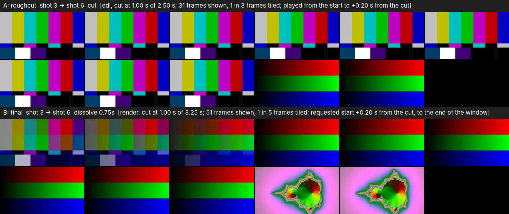
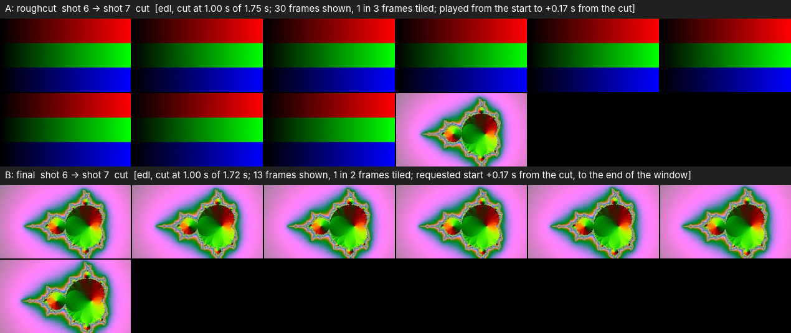
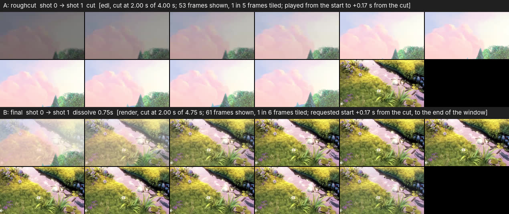

# M2b acceptance: can a cut be judged by watching it?

M2b adds temporal review to the Edit workbench: `p` plays the window around the
selected junction in mpv, `a` flips between the first cut and the refined cut of
the same junction at the same moment relative to the cut, and `s` pauses. Hard
cuts play straight from the source through an mpv EDL with no rendering; a window
with a transition, a fade or music is rendered by a short ffmpeg run. The same
review runs from a terminal with `python -m matchcut.review WORKSPACE --index N --ab --play`.

Design: [superpowers/specs/2026-10-18-m2b-temporal-review.md](superpowers/specs/2026-10-18-m2b-temporal-review.md).
M1's gate ([M1-ACCEPTANCE.md](M1-ACCEPTANCE.md)) is independent and still open.

## Status

- **Automated checks: pass** (see below).
- **Human checklist: PENDING.** Nobody has yet watched a junction in a real mpv
  window, heard the audio, or compared it with `final.mp4`. Everything under
  "Demonstration" is headless evidence of what mpv displayed; none of it says
  whether motion and timing can be judged by eye.
- **M1's human gate is still open.**

## Automated evidence

Offline, deterministic, on synthetic footage; the tests that need mpv skip
without it.

| Module | What it proves |
|---|---|
| `tests/review/test_window.py` | The window around a junction (pre/post, clamping at 0 and at the end, a dissolve pulling the neighbouring clip in), the sub-timeline and its fades, when a window needs a render (a transition, a fade, music), the EDL text and its escaping, that an EDL is refused for a window that needs a render, a window reaching into the fade-out needing a render, and a zero `pre_seconds` window. |
| `tests/review/test_items.py` | `prepare_review`: a hard-cut junction is an EDL and runs no ffmpeg; a dissolve is rendered and blends mid-transition; audio is present only when the source has it; the file name is a content key, an identical second call is a cache hit and a changed window, config, source or kind gives a new file (a sub-frame edit gives a new EDL); A is the baseline stage's hard cut and B the refined dissolve; a rendered window has the source's size by default (320x180, `review.width` 0; square-pixel sources) and a non-zero width scales it; the A/B concat file; one-line errors that leave no media behind; the music offset; a rendered window cut on the frame-snapped timeline (an EDL on the unsnapped one); no music fade-out in a window that stops mid-cut (RMS of the last half second within 20 % of the middle, measured 0.999) and a fade where the window reaches the end of the cut (0.093); old files in `review/.tmp` swept. |
| `tests/review/test_mpv.py` | The JSON IPC client against a real headless mpv: an EDL window loads with its chapters, `loop-file` wraps the window, a missing file or an unknown property raises, an idle session survives and answers after the command timeout, a late reply is dropped, `close` never hangs and removes the socket directory, a missing binary raises `MpvError`; the session args (`--hr-seek=yes`, `--no-resume-playback`); the second chapter at the cut; mpv exiting when the app is killed (Linux) and surviving the worker thread that started it. |
| `tests/review/test_controller.py` | The controller's command order (open at the target, loop, unpause, label), no frame from before the target's frame after a toggle (real mpv, `--vo=image`, sources whose frames draw their own number as black and white blocks, so the check is exact: B opens on frame 83 and none earlier is written), `auto-window-resize` set to `no` exactly once per session right after the first load (fake session; a real headless mpv reads it back) and an mpv without the option tolerated, A to B to A at cut+0.3 landing within one frame on both at the same offset from each cut (within half a frame) with the same display size, `dwidth` and `dheight` (real mpv, held paused), A/B toggling that keeps the offset from the cut (real mpv, headless), a toggle when the position cannot be read, a dead mpv restarted once, the status strings, the system-opener fallback without mpv (and the refusal of an EDL item there), the session surviving pause and silence with no second mpv spawned, mpv closed by the controller, `s` after the window was closed, the retry of a failed mpv start (fake clock), and the `python -m matchcut.review` CLI (Enter after closing the window replays; a malformed workspace prints one line). |
| `tests/tui/test_review_ui.py` | `p`, `a` and `s` in the Edit view; the `#review-status` line and the idle hint naming the baseline stage; preparation in a thread worker that leaves the keys responsive; a second request for the same item ignored; a result for a junction no longer selected not overwriting the selected junction's status; errors shown without stopping the app; the rendered fallback without mpv; the controller closed on exit; the `s` key labelled Pause; and one test with a real headless mpv. |

Measured A/B toggle accuracy (real mpv, headless, 25 fps footage): after toggling
from A to B at 1.300 s from its start, B's `time-pos` read 1.320 s, within one frame.
Measured window size (mpv 0.37 with a real X11 window under Xvfb, `--vo=x11`, 320x180
source, one run per setting): with the renders scaled to 160 px (`review.width=160`) and
`auto-window-resize` left alone the window went 320x180 -> 160x90 -> 320x180 over A -> B -> A;
with the setting it stayed 320x180 in all three; with the default `review.width` of 0 it
stayed 320x180 either way. This used `--vo=x11`. mpv documents `auto-window-resize` for Wayland, Win32 and X11 only: with the controller's real arguments (no `--vo`) mpv 0.37 under Xvfb picked `vo=sdl` and resized 320x180 -> 160x90 with `review.width=160` despite the setting. So on other video outputs and platforms only the default width 0 keeps the size, and a non-zero width (or an old 640 config) can still resize there. This is a software X server, not a desktop: how a real window manager (or macOS) treats the size is still part of the pending checklist.

## Demonstration

`tools/demo_review.py` drives the real `ReviewController` against a real mpv
(0.37.0 here) started with `--vo=image`, so every frame mpv displays is written
as an image. For each junction it prepares the A/B pair, plays A from the start
until just after A's cut, calls `toggle()` to B at the same offset from the cut,
plays B to the end of its window, and tiles the captured frames into one sheet:
the top half is A, the bottom half is B, and each caption names the item, its
kind (EDL or render), the transition, where the cut is and the offset of the
toggle.

| Image | Footage | What it shows |
|---|---|---|
|  `m2b-review-synthetic-j3.jpg` | Synthetic, junction 3 (shot 3 to shot 6) | A is the rough cut's hard cut from colour bars to a gradient, played from the source by EDL; B is the final cut's 0.75 s dissolve, a rendered window: the bars blend into the gradient over three tiles. A stops 0.20 s after the cut and B is opened at the same offset, 0.20 s after its cut (the requested position the caption states; the first frame B shows is the one at that position), so B's first tile is already part way through the blend; B's last two tiles are the next shot (the window runs on past shot 6). The synthetic footage cuts on whole frames, so shot 6 starts exactly at 14.00 s (frame 350) and no frame of the previous shot follows the cut. |
|  `m2b-review-synthetic-j4.jpg` | Synthetic, junction 4 (shot 6 to shot 7) | A hard cut from a gradient to a fractal on **both** sides: A and B are both exact-source EDLs (nothing rendered); A plays up to 0.17 s after the cut, B is opened at 0.17 s after its cut and plays to the end of its window, so B shows only the incoming shot. |
|  `m2b-review-bbb-j1.jpg` | Big Buck Bunny (20 s clip, mock backend) junction 1 (shot 0 to shot 1) | A is the rough cut's hard cut from the clouds to the grass; B is the final cut's 0.75 s dissolve between them, rendered; B was opened 0.17 s into the dissolve (the offset A was left at), so its first tiles are the rest of the blend. The first tiles of A are dim because the source itself fades in. The three sheets were regenerated after the open-at-target and window-size fixes: both halves are now at the source resolution (`review.width` 0), and the B caption states the requested start offset, not a `time-pos` read after playback resumed. |
| [`m2b-edit-review.svg`](screenshots/m2b-edit-review.svg) | Big Buck Bunny, final stage, junction 1 | The Edit tab after `p`: the footer lists `p Play`, `a A/B`, `s Pause`, and the `#review-status` line reads `playing final  shot 0 -> shot 1  dissolve 0.75s (rendered, cached)`. The controller is the real one but its mpv session is a stub, so nothing was played; the line shows the controller's own status text. |

Regenerate (the synthetic workspace is built from `make_demo_footage` with the
mock backend, fades off and a 1.0 s / 1.5 s window so that the last junction
qualifies for exact playback; the Big Buck Bunny workspace is a mock-backend run
of the 20 s clip):

    python3 tools/demo_review.py /tmp/m2b-synth /tmp/m2b-out --make-synthetic --index 3 --index 4
    python3 tools/demo_review.py WORKSPACE /tmp/m2b-out --index 1 --svg m2b-edit-review.svg

Footage credit: [screenshots/README.md](screenshots/README.md).

What the headless run proves:

- mpv, driven by the controller's IPC commands, displayed the frames of A and then
  of B: the EDL item played the source's hard cut and the rendered item the
  dissolve.
- The toggle moved to B at the same offset from the cut: A was left at +0.20 s
  (synthetic j3), +0.17 s (synthetic j4) and +0.17 s (Big Buck Bunny) from its cut
  and B was opened at that offset from its own cut (the captions give the requested
  offset). The `time-pos` read right after the toggle runs a little ahead of it,
  because playback has resumed by then (+0.24 s, +0.24 s and +0.21 s; one to two
  frames); the automated test with held playback measures the landing exactly
  (frame 83 asked for, frame 83 first shown; within one frame of cut+0.3 on both).
- mpv's `--vo=image` frames do not include the OSD label: the label is shown for
  2 s after each load and none of the frames in that period shows text. The
  caption bars in the sheets are drawn by the tool, not by mpv.
- Preparation cost on this machine (Big Buck Bunny, 720p source): an EDL is a
  text file; the 4.75 s rendered B window, now at the source's 1280x720, plus the
  EDL took about 6.5 s the first time (including Python start-up; about 4.5 s when
  windows were scaled to 640 px) and about 0.3 s once cached.

What it does not prove:

- That anything looks right on a screen: there was no window, no scaling to a
  display, no colour management.
- That a real desktop window keeps its size when A/B is toggled: that was measured
  under Xvfb only (see above), not on a desktop with a window manager.
- Sound: audio was off (`--ao=null`); whether the audio of a window matches the
  final cut is unchecked.
- Looping under a visible VO. The controller sets `loop-file=inf` for all real
  playback, but the loop is only tested with `--vo=null`. Wrap-around, and
  toggling A/B across a loop boundary, were not exercised with a window or any
  other visible VO; under mpv 0.37 `--vo=image` crashed now and then when a
  looping file restarted, and what a real window does is unknown.
- That the OSD label (the item's name for 2 s after each load) appears in a real
  window: `--vo=image` frames do not include it.
- Real-time smoothness, input lag, or how `←`/`→` feel while a window prepares.
- The editor's judgement: whether watching these windows lets someone assess
  motion and timing is the question below.

Two things about the tool itself. With mpv 0.37, `--vo=image` crashed now and
then when a looping file restarted (the open question above), so the tool never lets a file loop (A stops
shortly after its cut, B stops at the end of its window) and retries a crashed
run up to three times; A is held (paused) at the toggle point, and no frame is dropped: B is opened at
its target, so the first frame mpv writes for B is the frame at the target (an
automated test with a frame-ramp source checks that no frame from before the
target is ever shown; earlier the first one or two frames after a toggle were the
start of the other window, about 2 s before the cut). The tool's
sheets show A only up to the toggle and B only after it. The scratch frames of
each run (`OUTDIR/work-j<N>/`) are deleted when the sheet is built.

## Human checklist

Needs a desktop with mpv installed (`mpv --version`) and a workspace made by a
real run (`python -m matchcut.tui footage.mp4 -w ws_m2b --backend anthropic`),
with the Edit tab open (`4`).

1. Does the mpv window take keyboard focus from the terminal when it opens? (It
   would break the `a` workflow: the next key must still reach the app.) Then, on
   three junctions, including one with a dissolve and one a pass moved, press
   `p`, then `a`, then `a` again, then `s`. Each press does what the footer says;
   the status line reads `playing final ...` (after `p` the label has no prefix),
   `playing A  roughcut ...`, `playing B  final ...`, `paused` (the `s` key is
   labelled Pause). The item's name
   also appears as a label in the mpv window for about 2 s after each load
   (never verified in a real window).
   The window must also keep its size (no resize) and show both items at the
   same display size when you toggle (checked under Xvfb with `--vo=x11` only).
2. Let a window loop at least three times in the real mpv window, with `p` and
   again after `a`, and press `a` just before and just after the wrap: no crash,
   stutter or lost position (looping was never exercised with a visible VO).
3. Latency of the first prepare: a hard-cut window that plays from an EDL, and a
   window that has to be rendered. Note both delays and whether the tab stays
   usable meanwhile.
4. The transition and the sound in mpv match `final.mp4` played around the same
   cut (the window starts `review.pre_seconds`, 2 s by default, before the cut,
   so the cut is 2 s into the window; `python -m matchcut.review WORKSPACE
   --index N` prints it as `cut=`).
5. `←`/`→` and `[`/`]` respond immediately while a junction is still preparing,
   and a second `p` on the same junction says `already preparing this junction`.
6. Make mpv unavailable (uninstall it, rename the binary, or set
   `"review": {"mpv": "no-such-mpv"}` in `ws_m2b/config.json`) and press `p`: the
   window is rendered and opened in the system player, and the status line reads
   `mpv not found: opened <file> in the system player (no A/B toggle)`. Press `a`:
   the A/B file with both halves and burned-in labels opens.
7. Rename the source footage and press `p`: the status line reads
   `review failed: source footage not found: <path>` and the app keeps running.

## Verdict

| Question | Answer |
|---|---|
| Motion and timing judgeable by watching the window (yes/no) | |
| A/B at the same offset from the cut is useful (yes/no) | |
| Notes: first-prepare latency, what was hard to judge | |
| Decision | keep mpv review as the editor's way to watch a cut / change the approach |

## Known limitations

- An EDL item shows hard cuts only: a window with a transition, a fade or music
  is rendered by ffmpeg instead, so those are exactly what the render shows, not
  what mpv would compose.
- Loudness normalisation and ducking run on the rendered excerpt, not on the
  whole cut, so levels can differ slightly from `final.mp4`; `loudnorm` on a 4-6 s
  excerpt can also pump (a level that moves within the window).
- The music fade-out is applied only where the window reaches the last clip (a
  window that stops earlier gets a 1 ms fade, which is inaudible). So a fade
  that `final.mp4` applies before the last clip is not in the windows that stop
  before it: when the last clip is shorter than `music.fade_out`, the fade in
  `final.mp4` starts in an earlier clip and a review window of that stretch
  plays the music at full level; and when the music track ends before the cut
  does, `final.mp4` fades out to the track's end, while a window that ends
  mid-cut but contains the track's end ends the music with the 1 ms fade
  instead (from the render code; not listened to). The
  excerpt is trimmed from a render of the clips around the junction, so only a
  fade at the very end of the cut, in a window that reaches the last clip, is
  reproduced. Also, when the window's clips total less than 2 x `music.fade_out` while
  the whole cut is longer, a window that reaches the end shows a shorter fade than
  `final.mp4` (the fade is `min(fade_out, available / 2)` on the sub-timeline).
- Rendered windows are at the source resolution by default (`review.width` 0), so a
  4K source renders 4K windows (slower to prepare, bigger files); set a non-zero
  `review.width` to scale them, and the A/B windows then differ in size (the
  window no longer resizes, but the scaled item is fitted into it). A `config.json`
  written by an earlier version holds `"width": 640` until changed. A user's
  `auto-window-resize` setting in `mpv.conf` is overridden by the session.
- Shot starts come from the 8 fps analysis grid: a detected start lies on a 1/8 s step, from about one frame early to about 1.4 frames late (25 fps), so a clip can open with one frame of the previous shot; this is visible in review windows and in `final.mp4`. Full-rate refinement is a follow-up.
- Rendered windows follow `final.mp4` for anamorphic (non-square-pixel) sources: `setsar=1` without scaling squashes them, while an EDL item plays at the display aspect, so for such sources A and B differ in aspect (pipeline follow-up: scale by `iw*sar` before `setsar=1`).
- If starting mpv fails, the app plays through the system player and tries mpv
  again after 30 s or when `review.mpv` changes. On macOS and Windows an mpv left
  open by a killed app is not closed automatically (Linux does it).
- mpv control on Windows is not implemented: `start()` raises `MpvError` and the
  controller falls back to the system opener.
- The fallback has no A/B toggle beyond the concat file (A, half a second of
  black and silence, B, with burned-in labels).
- Looping is open under a real window: `loop-file=inf` is set for all playback
  but was only tested headless (`--vo=null`); mpv 0.37's `--vo=image` crashed on
  loop restarts and real-window behaviour is unknown (checklist item 2).
- Previews are never deleted automatically: `workspace/review/` grows by one file
  per distinct junction window; delete the folder to clear it.
