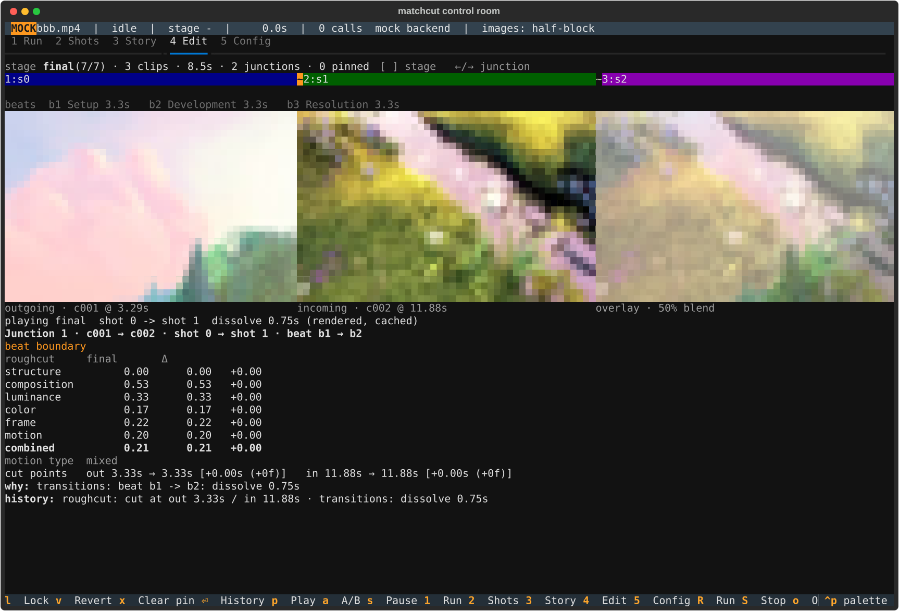

# Control-room TUI

`python -m matchcut.tui footage.mp4 [-w workspace] [-b brief] [-t seconds] [--music track.mp3] [--backend mock]`

A terminal app that drives and watches pipeline runs and inspects the
workspace they produce. Install with `pip install -r requirements-tui.txt`
on top of the pipeline requirements. Open an existing workspace without starting a run
with `python -m matchcut.tui -w footage_edit` (R, u and config saves still write to it).

## Views

| Key | View | What it shows |
|---|---|---|
| `1` | Run | the stage ladder (pending / cached / running / done / waiting / failed), the live log of events and decisions (`f` cycles the filter), and the checkpoint panel |
| `2` | Shots | the shot catalog; selecting a row shows head / middle / tail frames and Claude's description; `u` toggles the shot's usable flag (written to `descriptions.json` and seen by a redo in the same run) |
| `3` | Story | logline, theme, beats as cards; with music, the energy curve with beat-change markers |
| `4` | Edit | the cut as a workbench of junctions (see below): a track with the selected junction highlighted (select with `←`/`→` or a click on a junction glyph; `[`/`]` inspect an earlier stage), the beat strip, the outgoing, incoming and 50% overlay frames, and an inspector with badges, scores (rough cut vs the inspected stage), cut-point deltas, why and history; `l` lock, `v` revert, `x` clear pin, `Enter` full history, `o` opens the blend |
| `5` | Config | the live config as a tree; Enter edits a value (Esc cancels); the pipeline reads the live config, so an edit made mid-run can affect the stages still to come |

Global keys: `R` run, `S` stop (aborts a pending checkpoint), `o` open the
current image or render in the system viewer, `?` help, `q` quit (twice while
a run is active).

`o` opens the latest render (`final.mp4`, else `final_proxy.mp4`) from the Run
view, the highlighted shot's middle frame from Shots, and the
blended overlay image of the selected junction from Edit. On other views it says there is nothing to open.

## Edit

The Edit tab explains why each cut is where it is. The header line gives the
inspected stage (`final (8/8)`), its clip and junction counts, the number of
pins and any pins that could not be placed. Under it, the track shows the
clips as coloured spans with the selected junction highlighted. Select a
junction with `←`/`→` or by clicking its glyph; `[` and `]` move the inspected
stage between the rough cut and each pass. Junctions are followed across stages
by lineage (same shot, overlapping source range), because passes renumber
clips.

Below the beat strip are three frames: the outgoing frame (the last frame
before the cut), the incoming frame, and a 50% overlay of the two, which is the
quickest way to judge shape and position for a match cut. The inspector shows
the badges (match type, beat boundary, locked, pin state), a score table (rough
cut against the inspected stage; one column when the inspected stage is the
baseline), the cut points with deltas in seconds and frames, the why line and
the history. `Enter` expands the full history and every decision. The footer
shows the keys that apply: `l Lock`, `v Revert`, `x Clear pin`, `⏎ History`,
`p Play`, `a A/B`, `s Pause`; `o` opens the blend image in the system viewer.

*Junction 1: the outgoing frame, the incoming frame, the overlay, then scores and history.*

*Junction 2, one `→` later: the track highlight, frames and inspector all follow the selection.*

Screenshots are captured headless from a workspace with
`python3 tools/capture_edit.py WORKSPACE OUTDIR --junctions N`; see
[screenshots/README.md](screenshots/README.md) for how these were made and the
footage credit.

### Watching a junction (mpv)

Stills and scores cannot show whether a cut lands on an action or a dissolve is
too long, so the Edit tab can play the moving sequence around the selected
junction in [mpv](https://mpv.io):

| Key | Does |
|---|---|
| `p` | Play the inspected stage's window around the junction (2 s before the cut to 2 s after the transition by default), looping (`loop-file`; verified headless only, see [M2B-ACCEPTANCE.md](M2B-ACCEPTANCE.md)). |
| `a` | A/B. The first press prepares and plays **A**, the same junction at its baseline stage (the first stage where its two clips are adjacent, usually the rough cut). Later presses on the same junction toggle A and B at the same offset from the cut. When the junction first appears at the inspected stage there is nothing earlier to compare and the status line says so. |
| `s` | Pause what was played (press `p` or `a` to play again; the mpv window stays open). When the mpv window has been closed the status line reads `mpv is not running`. |

One line under the frames, `#review-status`, shows what is happening:
`p play · a compare with roughcut` when idle, then `preparing the junction for
review...`, then after `p` `playing final  shot 0 -> shot 1  dissolve 0.75s
(rendered, cached)` (no A/B prefix). After `a` it reads `playing A  roughcut
shot 0 -> shot 1  cut (exact source)` and, after the next `a`, `playing B  final
shot 0 -> shot 1  dissolve 0.75s (rendered)`: the `A` / `B` prefixes appear only
in an A/B comparison. Other lines are
`paused` and `review failed: <message>`. Preparation and every mpv command run
in a thread worker, so `←`/`→` and `[`/`]` keep working; a second request for
the junction being prepared is ignored (`already preparing this junction`),
whichever of `p` and `a` asked first: an `a` pressed while `p` is still preparing
the same junction is rejected the same way. A
result for a junction you have since left still plays, because you asked for
it, but does not overwrite the selected junction's status line.

*The Edit tab after `p`: the controller is the real one, its mpv session a stub
(a headless capture), so nothing was played.*

How a window is played: a window of hard cuts plays straight from the source
through an mpv EDL (exact source ranges, nothing rendered, instant). A window
with a transition, a fade or music, or any window when `review.always_render`
is set, is rendered by a short ffmpeg run at the source resolution (`review.width`
0, the default; a non-zero width scales it) so that the
transition, fades and music are exactly what ffmpeg makes, and so that for square-pixel sources a rendered
window has the same size and aspect as an EDL window (an anamorphic source renders squashed, as `final.mp4` does); loudness
normalisation and ducking run on the excerpt. Files go to `workspace/review/`
(`<stage>_s<out>-s<in>_<key>.edl` or `.mp4`); the key is a hash of what the
window depends on, so a repeat is instant and an edit to the cut or the config
makes a new file. They are never deleted automatically.

mpv must be on `PATH` (or named in `review.mpv`); it is started on the first
`p` or `a` and quit when the app exits. Without mpv the window is rendered and
opened in the system player (`open` / `xdg-open`), the status line says `mpv not
found: opened <file> in the system player (no A/B toggle)`, and `a` opens one
file with A, half a second of black and silence, and B, with the labels burned in.
mpv control is not implemented on Windows (the same fallback applies there).

How mpv is started: `--idle=yes --keep-open=yes --hr-seek=yes --no-resume-playback`
plus the IPC socket, and nothing else is switched off, so your own `mpv.conf`,
key bindings, scripts and OSC are honoured (a script that changes seeking or
looping can change what you see). One exception, set over IPC after the first
file has loaded: `auto-window-resize=no`, so the window keeps its size when you
toggle between items (mpv would otherwise resize it to each file's video size; mpv documents the option for Wayland, Win32 and X11 only, and on a video output where it has no effect, only the default `review.width` 0 keeps the size, so a non-zero width or an old `640` config can still resize there;
an older mpv without the option just ignores the request, and it overrides the
same option in your `mpv.conf`). Every item is opened *at* its target position
(`start` is set before the load and reset after it), so a toggle never flashes
the start of the other window. If starting mpv fails (not installed, wrong
`review.mpv`), the app falls back to the system player and tries mpv again after
30 s or as soon as `review.mpv` changes, so installing mpv does not need a restart.
Closing the mpv window is fine: the next `p` or `a` opens a new one. On Linux
mpv is told to exit when the app dies, even when the app is killed; on macOS and
Windows an mpv left open by a killed app stays open until you close it (a normal
quit closes it). The
same review runs outside the TUI with `python -m matchcut.review`
([PIPELINE.md](PIPELINE.md#reviewing-a-junction-in-motion)), and
[M2B-ACCEPTANCE.md](M2B-ACCEPTANCE.md) is the procedure and the evidence so far.

### Pins

`l` locks the junction as inspected (its current cut points are kept); `v`
reverts it to the points of the first cut and keeps those; `x` clears the pin.
A pin is stored in `editorial.json` keyed by the two shots, so it survives
clips being renumbered and the rough cut being regenerated (the rough-cut
prompt is told to keep the two shots adjacent). It also remembers which piece
of each shot it was taken on, so a shot cut into several pieces keeps the right
one. When an older pin has no such memory, the nearest cut point picks the
piece and the badge adds `, piece chosen by nearest boundary: check it`; pieces
too close to tell apart are not placed. It takes effect on the next run:
until then the badge reads `pin pending: run again (R) to apply`. After a run
it reads `pinned (locked|reverted)`, or `pinned (...), adjusted to out X / in Y
to fit the clips` when the points had to be clamped, or `pin not placed:
<reason>` when the pin cannot be placed (a shot is not in the cut, another pin
holds a clip it would have to move, moving a clip would split or reorder the
beats, a jump-cut pin's shot appears only once in the cut, a shot has more than
one piece that fits the pinned point equally well, or the clips have no room). The badge is judged from the latest stage's history, so it reads the same
whichever stage you inspect, and the header counts the pins not placed. A
junction a later pass created (its baseline is not the rough cut) is placed by
moving one of its clips next to the other in the rough cut before the passes
run, unless that would split or reorder the beats or another pin holds a clip;
`l` and `v` say so ("the next run moves one of these shots next to the other,
unless that would split or reorder the beats or another pin holds them"). A beat
that holds a pinned clip is not reordered by the match-cut pass. A pin holds the
cut points, not the transition: a pinned beat boundary keeps its dissolve.
A pin made while a run waits at the describe, narrative or rough-cut checkpoint
applies in that run when you continue; at a pass checkpoint it applies on the
next run (`R`).
Pacing never drops a pinned clip. The file format and how pins are applied are
in [PIPELINE.md](PIPELINE.md#editorial-pins).

### Mock runs

When the backend is `mock` the status bar shows a MOCK badge and says
`mock backend` instead of token and cost figures, and stages that never ran
read `skipped` in the Run view. The scores in the inspector come from the deterministic scorer
and are real; the descriptions, narrative and polish decisions of a mock run
are not.

## Checkpoints

A run pauses after describe, narrative, rough cut and every pass. The Run view
shows the stage's summary and three choices: `c` continue, `r` redo that stage
with the note typed in the field (reach the field with Tab or the mouse, type
the note, press Enter or Esc to leave the field, then `r`), `a` abort. A redo
on describe, narrative or rough cut
clears the downstream caches and re-runs with the note added to the prompt as a
director's note; a redo on a deterministic pass only matters together with a
config change. Config edits made while paused are saved on the redo.

## Images

Frames render with the best protocol textual-image detects (Kitty graphics or
Sixel) and fall back to half-block mosaics, or to plain unicode blocks when
stdout is not a terminal. The terminal is probed once, when `python -m
matchcut.tui` imports textual-image, before the UI starts; the one-time notice
when the first frame appears, and the status bar, name the mode actually in use
(`kitty graphics`, `sixel`, `half-block` or `unicode`). Set
`MATCHCUT_TUI_IMAGES=halfcell` to force the half-block fallback.

## How it fits together

`matchcut/tui/bridge.py` runs `Pipeline.run()` on a thread and forwards its
events through a queue; the app applies them to `RunState` 20 times a second
and the views redraw from it. Checkpoints block the pipeline thread until the
Run view answers. Nothing in `matchcut/pipeline/` imports the TUI.

## Tests

`python3 -m pytest tests/tui` runs the TUI tests, including one SVG snapshot
per view (`tests/tui/__snapshots__/`). The snapshots show frames from the
generated demo footage, so they are tied to one ffmpeg build; regenerate with
`python3 -m pytest tests/tui/test_snapshots.py --snapshot-update` when they
drift.
