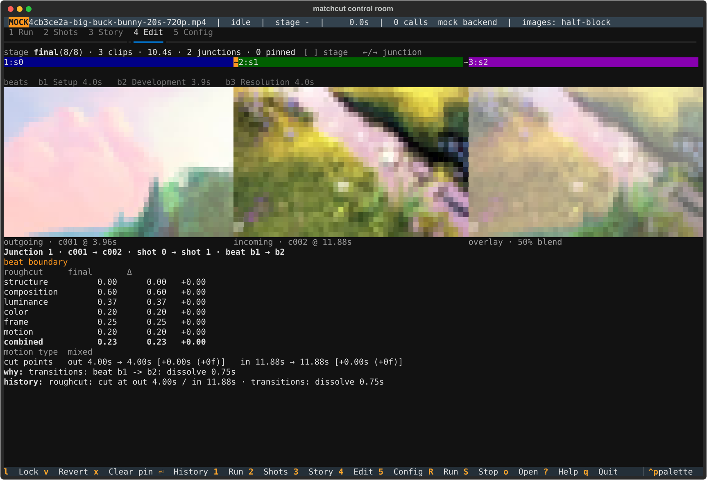
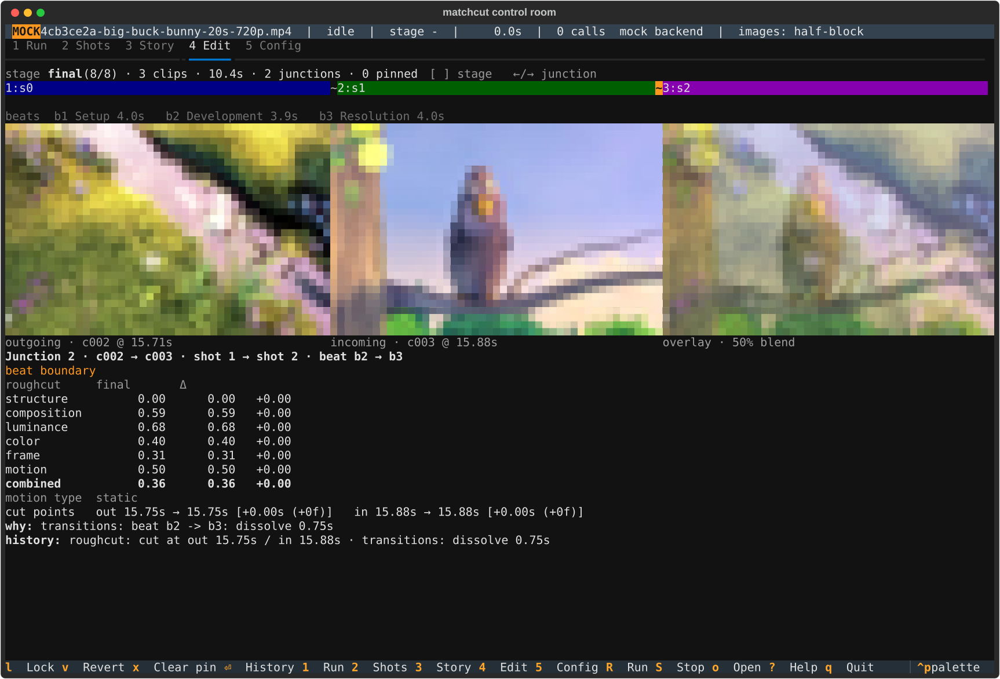

# Control-room TUI

`python -m matchcut.tui footage.mp4 [-w workspace] [-b brief] [-t seconds] [--music track.mp3] [--backend mock]`

A terminal app that drives and watches pipeline runs and inspects the
workspace they produce. Install with `pip install -r requirements-tui.txt`
on top of the pipeline requirements. Open an existing workspace without starting a run
with `python -m matchcut.tui -w footage_edit` (R, u and config saves still write to it).

## Views

| Key | View | What it shows |
|---|---|---|
| `1` | Run | the stage ladder (pending / cached / running / done / waiting / failed), the live log of events and decisions (`f` cycles the filter), and the checkpoint panel |
| `2` | Shots | the shot catalog; selecting a row shows head / middle / tail frames and Claude's description; `u` toggles the shot's usable flag (written to `descriptions.json` and seen by a redo in the same run) |
| `3` | Story | logline, theme, beats as cards; with music, the energy curve with beat-change markers |
| `4` | Edit | the cut as a workbench of junctions (see below): a track with the selected junction highlighted (select with `←`/`→` or a click on a junction glyph; `[`/`]` inspect an earlier stage), the beat strip, the outgoing, incoming and 50% overlay frames, and an inspector with badges, scores (rough cut vs the inspected stage), cut-point deltas, why and history; `l` lock, `v` revert, `x` clear pin, `Enter` full history, `o` opens the blend |
| `5` | Config | the live config as a tree; Enter edits a value (Esc cancels); the pipeline reads the live config, so an edit made mid-run can affect the stages still to come |

Global keys: `R` run, `S` stop (aborts a pending checkpoint), `o` open the
current image or render in the system viewer, `?` help, `q` quit (twice while
a run is active).

`o` opens the latest render (`final.mp4`, else `final_proxy.mp4`) from the Run
view, the highlighted shot's middle frame from Shots, and the
blended overlay image of the selected junction from Edit. On other views it says there is nothing to open.

## Edit

The Edit tab explains why each cut is where it is. The header line gives the
inspected stage (`final (8/8)`), its clip and junction counts, the number of
pins and any pins that could not be placed. Under it, the track shows the
clips as coloured spans with the selected junction highlighted. Select a
junction with `←`/`→` or by clicking its glyph; `[` and `]` move the inspected
stage between the rough cut and each pass. Junctions are followed across stages
by lineage (same shot, overlapping source range), because passes renumber
clips.

Below the beat strip are three frames: the outgoing frame (the last frame
before the cut), the incoming frame, and a 50% overlay of the two, which is the
quickest way to judge shape and position for a match cut. The inspector shows
the badges (match type, beat boundary, locked, pin state), a score table (rough
cut against the inspected stage; one column when the inspected stage is the
baseline), the cut points with deltas in seconds and frames, the why line and
the history. `Enter` expands the full history and every decision. The footer
shows the keys that apply: `l Lock`, `v Revert`, `x Clear pin`, `⏎ History`;
`o` opens the blend image in the system viewer.

*Junction 1: the outgoing frame, the incoming frame, the overlay, then scores and history.*

*Junction 2, one `→` later: the track highlight, frames and inspector all follow the selection.*

Screenshots are captured headless from a workspace with
`python3 tools/capture_edit.py WORKSPACE OUTDIR --junctions N`; see
[screenshots/README.md](screenshots/README.md) for how these were made and the
footage credit.

### Pins

`l` locks the junction as inspected (its current cut points are kept); `v`
reverts it to the points of the first cut and keeps those; `x` clears the pin.
A pin is stored in `editorial.json` keyed by the two shots, so it survives
clips being renumbered and the rough cut being regenerated (the rough-cut
prompt is told to keep the two shots adjacent). It takes effect on the next run:
until then the badge reads `pin pending: run again (R) to apply`. After a run
it reads `pinned (locked|reverted)`, or `pinned (...), adjusted to out X / in Y
to fit the clips` when the points had to be clamped, or `pin not placed:
<reason>` when the pin cannot be placed (a shot is not in the cut, another pin
holds a clip it would have to move, moving a clip would split or reorder the
beats, a jump-cut pin's shot appears only once in the cut, or the clips have no
room). The badge is judged from the latest stage's history, so it reads the same
whichever stage you inspect, and the header counts the pins not placed. A
junction a later pass created (its baseline is not the rough cut) is placed by
moving one of its clips next to the other in the rough cut before the passes
run, unless that would split or reorder the beats or another pin holds a clip;
`l` and `v` say so ("the next run moves one of these shots next to the other,
unless that would split or reorder the beats or another pin holds them"). A beat
that holds a pinned clip is not reordered by the match-cut pass. A pin holds the
cut points, not the transition: a pinned beat boundary keeps its dissolve.
A pin made while a run waits at the describe, narrative or rough-cut checkpoint
applies in that run when you continue; at a pass checkpoint it applies on the
next run (`R`).
Pacing never drops a pinned clip. The file format and how pins are applied are
in [PIPELINE.md](PIPELINE.md#editorial-pins).

### Mock runs

When the backend is `mock` the status bar shows a MOCK badge and says
`mock backend` instead of token and cost figures, and stages that never ran
read `skipped` in the Run view. The scores in the inspector come from the deterministic scorer
and are real; the descriptions, narrative and polish decisions of a mock run
are not.

## Checkpoints

A run pauses after describe, narrative, rough cut and every pass. The Run view
shows the stage's summary and three choices: `c` continue, `r` redo that stage
with the note typed in the field (reach the field with Tab or the mouse, type
the note, press Enter or Esc to leave the field, then `r`), `a` abort. A redo
on describe, narrative or rough cut
clears the downstream caches and re-runs with the note added to the prompt as a
director's note; a redo on a deterministic pass only matters together with a
config change. Config edits made while paused are saved on the redo.

## Images

Frames render with the best protocol textual-image detects (Kitty graphics or
Sixel) and fall back to half-block mosaics, or to plain unicode blocks when
stdout is not a terminal. The terminal is probed once, when `python -m
matchcut.tui` imports textual-image, before the UI starts; the one-time notice
when the first frame appears, and the status bar, name the mode actually in use
(`kitty graphics`, `sixel`, `half-block` or `unicode`). Set
`MATCHCUT_TUI_IMAGES=halfcell` to force the half-block fallback.

## How it fits together

`matchcut/tui/bridge.py` runs `Pipeline.run()` on a thread and forwards its
events through a queue; the app applies them to `RunState` 20 times a second
and the views redraw from it. Checkpoints block the pipeline thread until the
Run view answers. Nothing in `matchcut/pipeline/` imports the TUI.

## Tests

`python3 -m pytest tests/tui` runs the TUI tests, including one SVG snapshot
per view (`tests/tui/__snapshots__/`). The snapshots show frames from the
generated demo footage, so they are tied to one ffmpeg build; regenerate with
`python3 -m pytest tests/tui/test_snapshots.py --snapshot-update` when they
drift.
